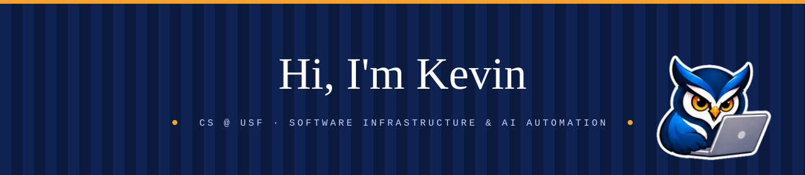
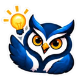
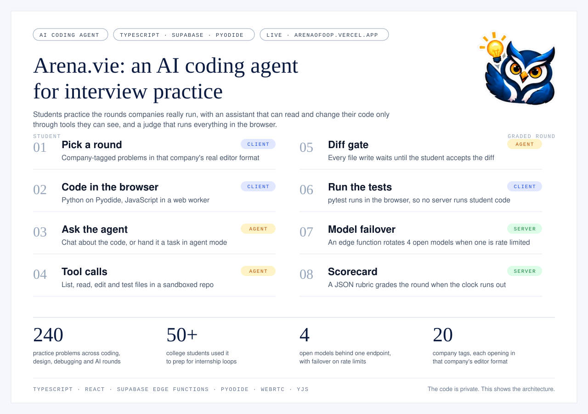
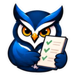

  
  
  

  
  

---

##  About me

Hi guys, I'm **Kevin**, or **Tuan Khang**, either way works. I study **Computer Science at USF**.
I love working on **software infrastructure** and **AI automation**, and I'm on my way to becoming a Software Engineer.
Off the keyboard, you'll find me watching movies or playing Honor of Kings and PUBG.

##  Arena.vie

My interview practice platform, with an AI coding agent that helps you through each round. The code is private, so here is how it works.

  

##  Experience

<table>
  <tr>
    <td width="50%" valign="top">
      <h3> Moffitt Cancer Center</h3>
      <i>Student Software Engineer · Dec 2025 to Aug 2026</i>  
      Built an agent that runs and fixes cancer research ML experiments on its own.
    </td>
    <td width="50%" valign="top">
      <h3> Prox</h3>
      <i>Software Engineer Intern · Nov 2025 to May 2026</i>  
      Scaled the platform that keeps retailer prices and inventory up to date.
    </td>
  </tr>
  <tr>
    <td width="50%" valign="top">
      <h3> VNPT-IT</h3>
      <i>Software Engineer Intern · May to Aug 2025</i>  
      Shipped an AI assistant and an email copilot for the company's staff.
    </td>
    <td width="50%" valign="top">
      <h3> ACM @ USF</h3>
      <i>Technical Lead · May 2025 to Apr 2026</i>  
      Ran hands-on workshops on building AI agents for 200+ students.
    </td>
  </tr>
</table>

##  Tech stack

  

##  My projects

<table>
  <tr>
    <td colspan="2" valign="top">
      <h3> <a href="https://github.com/DinhPhucLe/sentinel">Sentinel.ai</a></h3>
      A hackathon project with my team: satellites on a 3D globe, with an AI agent that spots close approaches as they happen.  
      
      
      
      
    </td>
  </tr>
  <tr>
    <td width="50%" valign="top">
      <h3> <a href="https://github.com/khangpt2k6/CostPilot">CostPilot</a></h3>
      A gateway that keeps AI spending inside a budget, down to the last token.  
      
      
    </td>
    <td width="50%" valign="top">
      <h3> <a href="https://github.com/khangpt2k6/Slipstream_CDC">Slipstream</a></h3>
      Change one row in a database and watch it reach a live dashboard.  
      
      
    </td>
  </tr>
  <tr>
    <td width="50%" valign="top">
      <h3> <a href="https://github.com/khangpt2k6/EventBus">EventBus</a></h3>
      A small Kafka-style message bus I built to see what a queue really costs.  
      
      
    </td>
    <td width="50%" valign="top">
      <h3> <a href="https://github.com/khangpt2k6/UrbanFlow">UrbanFlow</a></h3>
      A tiny simulated city where one badly timed traffic light can jam a whole street.  
      
      
    </td>
  </tr>
  <tr>
    <td width="50%" valign="top">
      <h3> <a href="https://github.com/khangpt2k6/NaviCV">NaviCV</a></h3>
      Upload your resume and it finds the roles that fit you.  
      
      
    </td>
    <td width="50%" valign="top">
      <h3> <a href="https://github.com/khangpt2k6/RustProxy">RustProxy</a></h3>
      A reverse proxy in Rust that spreads traffic across servers.  
      
      
    </td>
  </tr>
</table>

##  Contribution snake

  <picture>
    <source media="(prefers-color-scheme: dark)" srcset="https://raw.githubusercontent.com/khangpt2k6/khangpt2k6/output/github-snake-dark.svg" />
    <source media="(prefers-color-scheme: light)" srcset="https://raw.githubusercontent.com/khangpt2k6/khangpt2k6/output/github-snake.svg" />
    
  </picture>

##  Let's connect

  
  

